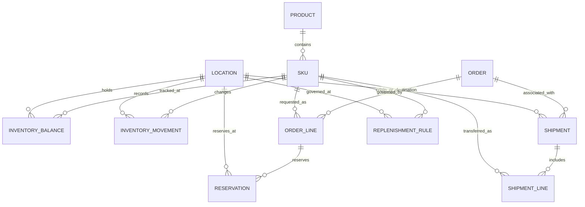

# YottaFlex Inventory — Database Schema

## 1. Overview

The inventory system models product catalog data, stock-keeping units, physical locations, inventory balances, immutable movement history, orders, reservations, shipments, and replenishment policies.

The SQLAlchemy model definitions in `app/models.py` are the authoritative implementation of the relational schema.

## 2. Entity Relationships



The diagram expresses the intended logical relationships. Verify exact nullability, delete behavior, uniqueness, and relationship configuration against `app/models.py`.

## 3. Core Entities

| Entity | Primary key | Purpose |
|---|---|---|
| Product | `product_id` | Product catalog information |
| SKU | `sku_id` | Stock-keeping unit master data |
| Location | `location_id` | Warehouse, store, or other inventory location |
| InventoryBalance | `id` | Current recorded quantities for a SKU/location pair |
| InventoryMovement | `id` | Historical inventory movement events |
| Order | `id` | Order header |
| OrderLine | `id` | SKU and quantity associated with an order |
| Reservation | `id` | Stock reserved for an order line |
| Shipment | `id` | Shipment or transfer lifecycle record |
| ShipmentLine | `id` | SKU and quantity associated with a shipment |
| ReplenishmentRule | `id` | Replenishment policy for inventory |

The primary-key names above refer to the ORM model identifiers. CSV export identifiers may use different names such as `sku_id` or `movement_id`.

## 4. Relationship and Integrity Rules

- Every SKU references an existing product.
- Inventory balances reference an existing SKU and location.
- Inventory movements reference an existing SKU and location.
- Every order line belongs to an existing order and references a valid SKU.
- Reservations reference valid order lines and locations.
- Shipments reference valid locations and may reference an order.
- Shipment lines reference an existing shipment and SKU.
- Replenishment rules reference valid SKU and location records.
- Quantities must follow the relevant non-negative or positive-quantity constraints.
- Inventory changes should be recorded through movement history rather than silently rewriting historical events.

## 5. Inventory Quantity Model

The application calculates available-to-promise stock using:

```text
ATP = on_hand - reserved - blocked - safety_stock + approved_inbound
```

A sale must not consume stock reserved for other orders, blocked stock, or protected safety stock. Damaged quantities should be represented through the blocked-stock policy and corresponding movement history.

## 6. Reservation Lifecycle

A reservation has a lifecycle state and expiry timestamp.

- Creation validates the order line, requested quantity, expiry time, and stock availability.
- Active reservations contribute to reserved stock.
- Expired active reservations should release their reserved quantity.
- Reservation processing must avoid over-reserving stock when concurrent requests occur.

## 7. Transfer Lifecycle

A transfer links a source location and destination location.

- Dispatch reduces available stock at the source and records a transfer-out event.
- Stock remains in transit until receipt.
- Receipt adds stock at the destination and records a transfer-in event.
- A transfer must not be counted as available at both locations simultaneously.
- Receipt timestamps must not precede dispatch timestamps.

## 8. Schema Initialization

The application initializes tables using the existing database initialization code:

```powershell
python -m app.init_db
```

This project currently uses SQLAlchemy table creation. A versioned migration strategy would be appropriate for production schema evolution.

## 9. Verification

Use `app/models.py` as the source of truth for exact SQL column types, foreign-key definitions, constraints, and ORM relationships. Use `generator/validate_challenge_dataset.py` to validate the generated CSV data independently of the live database.
